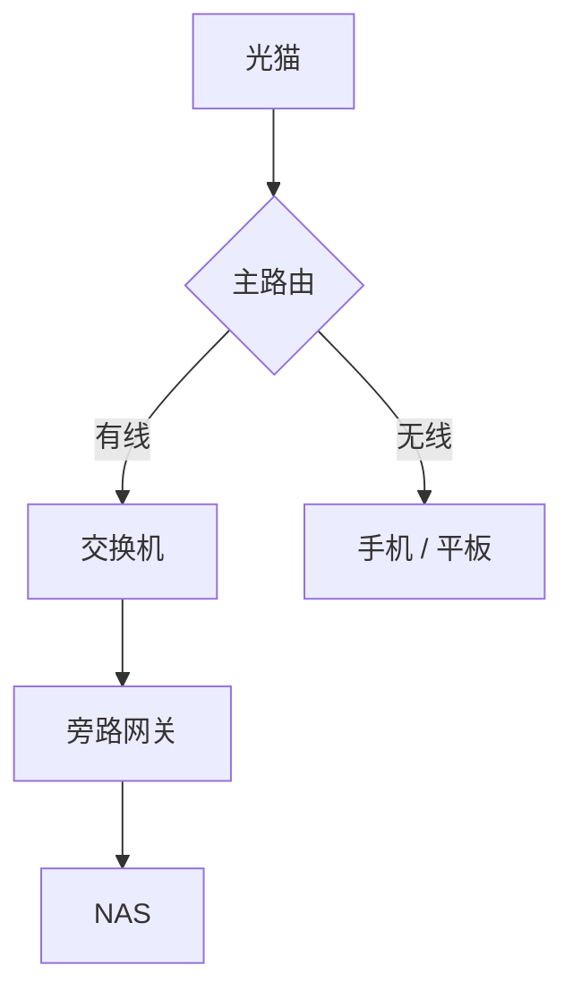

# 把宿舍网络折腾成能用的样子

这是一份**演示样张**，不是站上发布的文章。场景取自「喵二」博客里反复出现的那些真事——校园网认证、软路由、半夜断网、删库跑路——但细节经过改写和夸张，用来把 `src/lib/content/markdown.ts` 支持的每一种写法过一遍。

样张是静态文本，没有随机内容；图片全部来自仓库内 `public/visual-tests/` 的本地 SVG，不依赖网络。

---

## 一、这栋楼里的网

宿舍的网不是「网络」，更像三个人轮流赌气的一台机器。这篇样张要把它怎么坏的、怎么修好的写清楚，顺便把标题层级也走一遍——标题只到四级，五级和六级会被渲染器压回 `h4`。

### 光猫在谁的柜子里

这是三级标题。物业说光猫在弱电箱，宿管说在楼梯口，最后发现它在隔壁寝室书架后面，上面盖着一本《高等数学》。

#### 弱电箱这个词到底是谁发明的

这是四级标题。四级之后不再新增层级，视觉上靠字号与颜色区分。

##### 没有人真正拥有一根网线

这一行在 DOM 里是 `h4`，和上一节同级。

###### 所以最后还是接了无线

这一行同样是 `h4`。承认吧，最后的方案永远是无线。

## 二、先说清楚我要什么

我要的不多：**打游戏不掉线**、_看视频不转圈_、_**下载的时候别把别人挤死**_、~~顺便绕过校园网的限制~~、`一只不用天天登录的客户端`，以及一个[能看的归档页](/articles)。外链在这里：[OpenWrt 文档](https://openwrt.org/docs/start)。这次真正加进去的只有 ++一个定时重连++，被砍掉的是 ||那个会把整层楼带宽吃干净的下载器||。

行内代码里也能放符号：`const sum = (a: number, b: number) => a + b`。链接的颜色继承正文，靠下划线识别；外链在新窗口打开。

## 三、有人早就说过

> 旁路由只是旁路网关的意思。「旁路由」被叫顺口了，并不准确——旁路并不处理路由。
>
> 第二段仍在同一个引用块内。这是别人的话，所以它必须一眼能看出不是说自己的话。

## 四、代码

行内代码见上一节；下面是带语言标记的代码块，由 Shiki 在服务端着色，双主题通过 CSS 变量切换。没有文件名的块只有语言标识，标题栏仍然存在。

```ts
interface NetworkState {
  online: boolean
  gateway: string | null
  lastDropAt: string | null
}

export function describe(state: NetworkState): string {
  if (!state.online) return '又断了'
  return `在线，网关 ${state.gateway ?? '未知'}`
}
```

写了 `filename` 时，卡片多出一条独立标题栏，文件名在左、语言标识靠右、复制按钮始终在最右：

```tsx filename="src/app/notes/[id]/page.tsx" {3,7-9}
export default async function NotePage({ params }: Props) {
  const { id } = await params
  const note = await getNoteByNid(Number(id))
  if (!note) notFound()

  // 正文在服务端渲染，客户端只负责图片预览
  const { html } = await renderMarkdown(note.text)
  return <NoteBody html={html} />
}
```

`{3,7-9}` 这样的行号集合会把对应行整行标出，`[!code ++]` / `[!code --]` 记号则用于逐行标注增删：

```ts
const before = connectViaPortal() // [!code --]
const after = connectViaPortal({ bypassProxy: true }) // [!code ++]
const locale = await getLocale() // [!code highlight]
```

```bash
pnpm tauri build && MX_MOCK=1 PORT=3021 pnpm start
```

diff 语言按行首判定增删；文件头的 `---` / `+++` 与 hunk 的 `@@` 不参与增删配色：

```diff
--- a/src-tauri/src/cli.rs
+++ b/src-tauri/src/cli.rs
@@ -1,3 +1,3 @@
-connect / login / disconnect
+up / down / diagnose
 return status
```

单个语言标识、没有名字的纯文本块也照常成立：

```
普通文本没有语言标识，卡片进入无标题栏形态。这段话是凌晨三点写给自己的。
```

未知语言降级为纯文本着色，行号与标题栏不受影响：

```text-file filename="notes/todo.txt"
这里不是任何一种 Shiki 语言，内容仍然可读、可复制。
```

单行代码块只有一行行号：

```ts
export const SITE_NAME = '喵二の小博客'
```

空代码块也保留一行行号，不会塌成空白条：

```ts
```

长代码块默认折叠到半屏高度，底部是渐变遮罩与展开按钮；按钮出现前正文保持完整可读：

```ts
const DEVICES = [
  '光猫',
  '主路由',
  '旁路网关',
  '交换机',
  '台式机',
  '笔记本',
  'NAS',
  '打印机',
  '电视盒子',
  '手机',
  '平板',
  '电子书',
  '智能音箱',
  '摄像头',
] as const

const ALIASES: Record<string, string> = {
  gw: 'gateway',
  旁路: 'bypass',
  主线: 'wan',
  lan: 'lan',
  wifi: 'wireless',
  无线: 'wireless',
  ap: 'access-point',
  nas: 'storage',
}

export function normalizeRole(value?: string): string | undefined {
  if (!value) return undefined
  return ALIASES[value] ?? value
}

export function isKnownDevice(value?: string): boolean {
  const normalized = normalizeRole(value)
  return normalized ? (DEVICES as readonly string[]).includes(normalized) : false
}

export function countOnline(devices: string[]): number {
  return devices.filter((device) => isKnownDevice(device)).length
}
```

作者明确要求展开时用 `expand`，同样的长度也不再折叠：

```ts expand
export interface CatWrtConfig {
  hostname: string
  lan: {
    ip: string
    dhcp: boolean
  }
  bypass: {
    enabled: boolean
    gateway: string | null
  }
  ota: {
    channel: 'stable' | 'snapshot'
    auto: boolean
  }
}

export const DEFAULTS: CatWrtConfig = {
  hostname: 'CatWrt',
  lan: { ip: '192.168.10.1', dhcp: true },
  bypass: { enabled: false, gateway: null },
  ota: { channel: 'stable', auto: true },
}

export function mergeConfig(input?: Partial<CatWrtConfig>): CatWrtConfig {
  return { ...DEFAULTS, ...input }
}
```

## 五、算一下够不够用

行内公式 $e^{i\pi} + 1 = 0$ 与 $\sum_{k=1}^{n} k = \frac{n(n+1)}{2}$ 都在正文行内排版。至于「够不够用」这件事，从来不靠感觉。

块级公式独立成行，超宽时允许自身横向滚动：

$$
T_{\text{下载}} = \frac{S}{B \cdot \eta}, \qquad \eta \approx 0.72
$$

## 六、六条提醒

::: info
信息类提示：一根网线的理论速率和它跑出来的速率，通常差着一个「室友在**下载**」。
:::

::: note 关于那台 N5105
标题可以由作者覆盖，空标题会回落到类型标签。这台机器插满四个网口会死机，插三个就正常，属于玄学。
:::

::: success
完成类提示：认证脚本跑通了，连着三天没掉线，值得写进日记。
:::

::: warning
警告类提示：把旁路网关写进 DHCP 的网关选项之前，先想好它炸了以后谁背锅。
:::

::: error
错误类提示：拨号失败最常见的原因不是账号，是那根被老鼠咬过四截的网线。
:::

::: danger
危险类提示：`rm -rf` 之后没有回收站，只有 24 小时的沉默。
:::

## 七、五句忠告

> [!NOTE]
> NOTE 类型，结构复用 Callout，标签统一为中文。

> [!TIP]
> TIP 类型：把配置写成文件，别只记在脑子里。

> [!IMPORTANT]
> IMPORTANT 类型：改防火墙之前，先确认自己还能从内网进去。

> [!WARNING]
> WARNING 类型：侵入式旁路一挂，整层楼的设备一起掉线。

> [!CAUTION]
> CAUTION 类型：刷固件前把旧固件留在 U 盘里，这一步不可逆。

## 八、通栏

::: banner{info}
通栏提示没有标题，用于整篇文章级别的说明（例如「本文有后续更新」）。
:::

::: banner{warning}
同样支持其他类型；这一条用于对比左侧竖线与底色。
:::

## 九、折叠

::: details 展开看那次删库的经过

折叠块的原生语义是 `details` / `summary`，键盘可用，且不依赖 JS。

- 第一步：在错误的目录里执行了正确的命令
- 第二步：用 `JWT_SECRET` 太短的配置重启容器，无限重启

第二段文字用于观察展开后的间距。备份这件事，说一百遍不如疼一次。
:::

## 十、相册与轮播

相册容器只识别「整行独立的 Markdown 图片」，行尾跟说明文字的行不算相册项。

::: gallery


:::

::: carousel


:::

## 十一、图片与图注

单张图片会包一层 `figure` 并自动生成图注；点击图片会打开预览层。


## 十二、拓扑

代码块标记为 `mermaid` 时，服务端只输出源码与占位容器，图形由客户端补水；未补水时是可读的虚线占位框。



## 十三、设备表

| 设备     | 角色     | 备注                       |
| -------- | -------- | -------------------------- |
| 光猫     | `bridge` | 密码在贴纸上，贴纸在柜子后 |
| 旁路网关 | `bypass` | 炸了只影响静态指定的设备   |
| NAS      | `backup` | 两个月前的相册备份救过命   |

## 十四、脚注

正文里的第一处引用[^1]，同一标识符再次引用[^1]，以及另一个标识符[^note]。

[^1]: 第一条脚注，支持 **行内 Markdown** 与 `code`。

[^note]: 第二条脚注，用于观察脚注列表的编号与返回锚点。

## 十五、社交提及

提及按平台前缀渲染成链接：{GH@miaoermua}、{TW@miaoermua}、{TG@miaoer}。只有 GH / TW / TG 三个大写前缀会被解析。

## 十六、收尾

上面每个二级标题之间都用水平线与留白分隔；这一段用于确认文章末尾的收束间距。网络最后是通的，代价是一个周末和两根网线。

---

样张到此结束。
