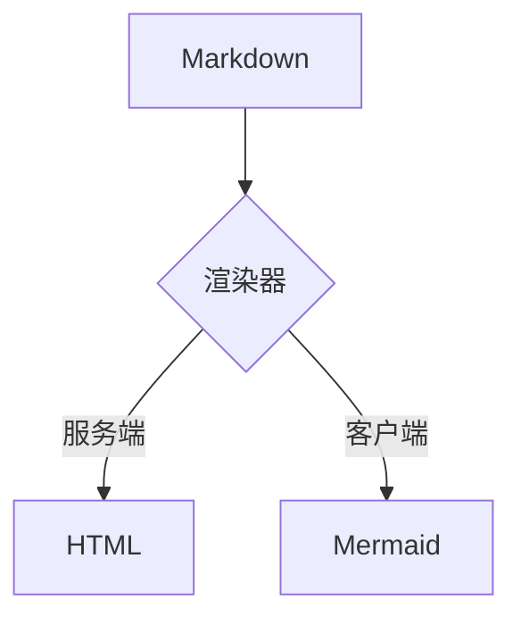

# Folio Markdown 视觉验收样张

本页是 **Phase 4D 视觉验收专用素材**，不是用户内容，也不会出现在站点导航里。它覆盖 `src/lib/content/markdown.ts` 实际支持的每一种扩展，用于在固定视口与主题下比对渲染结果。

样张是静态文本，没有随机内容；图片全部来自仓库内 `public/visual-tests/` 的本地 SVG，不依赖网络。

---

## 一、标题层级

Markdown 的 H1–H6 都会经过同一条渲染路径，但产物只有 h1–h4：渲染器把深度钳制在 1–4，所以 H5 与 H6 会落到 `h4`。这是既有行为，本节用于把它拍进基线。

### H3 三级标题

正文段落用于观察行高、字距与行宽。中文正文的呼吸感主要来自行高与段间距，而不是字号——这是 Folio 排版的基本判断。

#### H4 四级标题

H4 之后不再新增层级，视觉上靠字号与颜色区分。

##### H5 五级标题（渲染为 h4）

这一行在 DOM 里是 `h4`，与上一节同级。

###### H6 六级标题（渲染为 h4）

这一行同样在 DOM 里是 `h4`。

## 二、正文与行内标记

这一段包含 **加粗**、_斜体_、_**加粗斜体**_、~~删除线~~、`行内代码`、[站内链接](/articles)、[外链](https://example.com/folio-visual-fixture)，以及 ++新增内容++ 与 ||点击展开的剧透内容||。

行内代码里可以出现符号：`const sum = (a: number, b: number) => a + b`。链接的颜色继承正文，靠下划线识别；外链在新窗口打开。

## 三、引用块

> 引用的本质是「把别人的声音放到自己的正文里」，所以它必须一眼能看出不是说自己的话。
>
> 第二段仍在同一个引用块内。

## 四、代码

行内代码见上一节；下面是带语言标记的代码块，由 Shiki 在服务端着色，双主题通过 CSS 变量切换。

```ts
interface RenderedContent {
  html: string
  toc: Array<{ id: string; text: string; depth: 2 | 3 }>
}

export async function render(markdown: string): Promise<RenderedContent> {
  const lexed = lexer.lex(markdown)
  return { html: parser.parse(lexed), toc: [] }
}
```

```bash
pnpm build && MX_MOCK=1 PORT=3021 pnpm start
```

```diff
- const html = marked.parse(markdown)
+ const { html } = await renderMarkdown(markdown)
```

## 五、数学公式

行内公式 $e^{i\pi} + 1 = 0$ 与 $\sum_{k=1}^{n} k = \frac{n(n+1)}{2}$ 都在正文行内排版。

块级公式独立成行，超宽时允许自身横向滚动：

$$
\int_{0}^{\infty} \frac{x^{3}}{e^{x} - 1}\,\mathrm{d}x = \frac{\pi^{4}}{15}
$$

## 六、Callout 六型

::: info
信息类提示：正文支持 **行内 Markdown** 与 `代码`。
:::

::: note 自定义标题的笔记
标题可以由作者覆盖，空标题会回落到类型标签。
:::

::: success
完成类提示：用于「已经做完」的状态。
:::

::: warning
警告类提示：用于「注意后果」的状态。
:::

::: error
错误类提示：与危险分开，语气更偏「操作失败」。
:::

::: danger
危险类提示：破坏性操作前使用。
:::

## 七、GitHub Alerts 五型

> [!NOTE]
> NOTE 类型，结构复用 Callout，标签统一为中文。

> [!TIP]
> TIP 类型，用于「可以这样更好」。

> [!IMPORTANT]
> IMPORTANT 类型，用于「不能漏掉的前提」。

> [!WARNING]
> WARNING 类型，用于「会出问题」。

> [!CAUTION]
> CAUTION 类型，用于「可能不可逆」。

## 八、Banner 通栏

::: banner{info}
通栏提示没有标题，用于整篇文章级别的说明（例如「本文有后续更新」）。
:::

::: banner{warning}
同样支持其他类型；这一条用于对比左侧竖线与底色。
:::

## 九、Details 折叠

::: details 展开看实现细节
折叠块的原生语义是 `details` / `summary`，键盘可用，且不依赖 JS。

- 列表项一
- 列表项二，含 `code`

第二段文字用于观察展开后的间距。
:::

## 十、Gallery 与 Carousel

相册容器只识别「整行独立的 Markdown 图片」，行尾跟说明文字的行不算相册项。

::: gallery


:::

::: carousel


:::

## 十一、图片与图注

单张图片会包一层 `figure` 并自动生成图注；点击图片会打开预览层。


## 十二、Mermaid

代码块标记为 `mermaid` 时，服务端只输出源码与占位容器，图形由客户端补水；未补水时是可读的虚线占位框。



## 十三、表格

| 组件    | 负责文件         | 备注               |
| ------- | ---------------- | ------------------ |
| Callout | `containers.css` | 类型配色唯一实现处 |
| Gallery | `media.css`      | 图片预览同文件     |
| 脚注    | `footnotes.css`  | 返回锚点           |

## 十四、脚注

正文里的第一处引用[^1]，同一标识符再次引用[^1]，以及另一个标识符[^note]。

[^1]: 第一条脚注，支持 **行内 Markdown** 与 `code`。

[^note]: 第二条脚注，用于观察脚注列表的编号与返回锚点。

## 十五、社交提及

提及按平台前缀渲染成链接：{GH@Innei}、{TW@Innei}、{TG@innei}。只有 GH / TW / TG 三个大写前缀会被解析。

## 十六、分隔与结尾

上面每个二级标题之间都用水平线与留白分隔；这一段用于确认文章末尾的收束间距。

---

样张到此结束。
